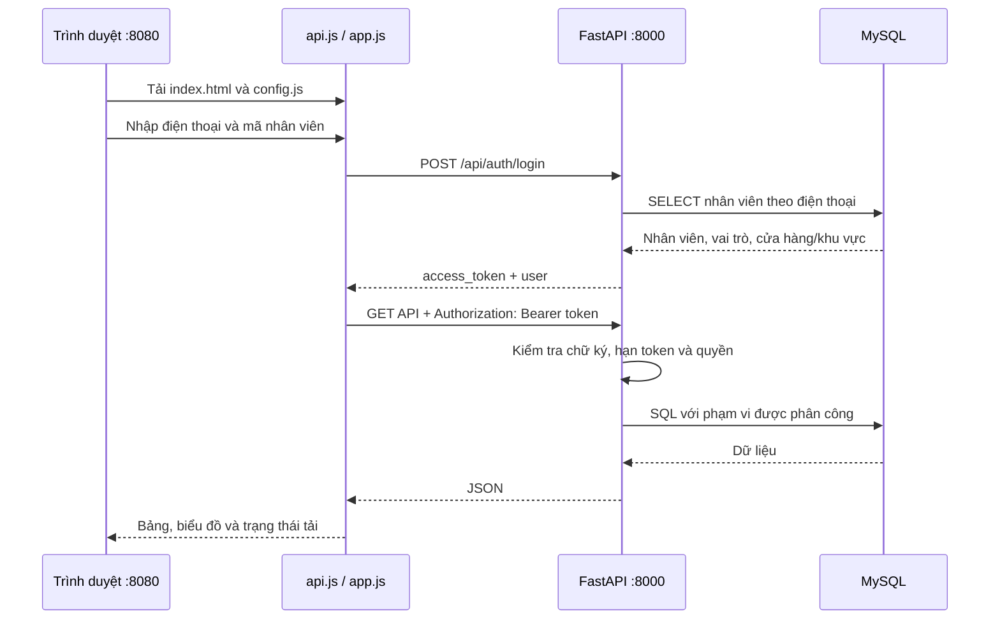

# Kết nối frontend – backend Fashion Manager

Tài liệu đối chiếu mã nguồn và kiểm tra tại máy ngày 26/10/2026.

## 1. Cấu trúc project

| Thư mục/file | Vai trò |
| --- | --- |
| `frontend/index.html`, `css/dashboard.css` | Giao diện HTML và định dạng; dùng thêm Tailwind CDN và Lucide CDN |
| `frontend/config.js` | URL backend công khai cho frontend; không chứa mật khẩu database |
| `frontend/js/api.js` | Hàm `fetch`, token trong bộ nhớ, đăng nhập/đăng xuất, xử lý lỗi và helper hiển thị |
| `frontend/js/app.js` | Điều hướng theo vai trò, tải sản phẩm/cửa hàng/nhân viên, form tạo đơn, form quản trị |
| `frontend/js/charts.js` | Vẽ biểu đồ và bảng đơn hàng từ JSON của API |
| `backend/main.py` | Khởi tạo FastAPI, CORS, đăng ký router, health check và xử lý lỗi MySQL |
| `backend/app/routers/` | Nhận HTTP request, xác thực, phân quyền và kiểm tra đầu vào |
| `backend/app/core/` | Đọc `.env`, ký/kiểm tra token HMAC và ánh xạ vai trò |
| `backend/app/schemas/` | Pydantic kiểm tra payload tạo đơn/nhân viên/lương |
| `backend/app/repositories/` | Đọc/ghi MySQL, transaction khi tạo đơn và cập nhật dữ liệu |
| `backend/app/db/` | Kết nối MySQL/TLS, nạp SQL và chuyển đổi truy vấn học thuật theo schema hiện tại |
| `sql/app/` | Các câu SQL tham số hóa; một số nghiệp vụ hiện vẫn dùng SQL viết trực tiếp trong repository |
| `sql/query/` | 51 truy vấn học thuật đăng ký sẵn cho admin |
| `sql/data/`, `sql/schema/`, `sql/tests/` | Các bộ schema/seed và ví dụ kiểm tra; cần chọn đúng bộ tương thích |
| `scripts/` | Chạy dev, kiểm tra DB/API/SQL, tạo cấu hình Pages/Render |
| `.github/workflows/` | Kiểm tra code, đóng gói frontend, deploy Pages và kiểm tra Aiven |
| `render.yaml` | Cấu hình chạy FastAPI trên Render |
| `reports/` | Bản thảo báo cáo và tài liệu kiểm thử; không được ứng dụng tải khi chạy |

## 2. Luồng kết nối



Frontend gọi `${API_BASE}${path}` qua `apiRequest()`. `API_BASE` lấy từ
`window.FASHION_MANAGER_API_URL`. Mọi request có phiên đăng nhập đều gắn Bearer token;
request đăng nhập và kiểm tra DB không cần token. Token hết hạn sau 12 giờ, chỉ lưu trong bộ nhớ;
F5 hoặc đăng xuất sẽ yêu cầu đăng nhập lại. HTTP 401 xóa phiên và đưa giao diện về đăng nhập.
HTTP 403 hiển thị lỗi quyền, không tự xóa phiên.

Khi chạy `scripts/dev.py`, frontend phục vụ `/config.js` trực tiếp trong bộ nhớ với đúng
`--api-port`. File cấu hình deploy trên đĩa giữ nguyên. Backend được kiểm tra `/health` trước
khi thông báo sẵn sàng. `/health` chỉ xác nhận tiến trình API; `/api/health/db` mới kiểm tra MySQL.

## 3. Từng màn hình gọi API nào?

| Chức năng | Hàm frontend | API | Quyền |
| --- | --- | --- | --- |
| Đăng nhập | `login`, `handleLogin` | `POST /api/auth/login` | Công khai |
| Kiểm tra phiên | API hỗ trợ; smoke test sử dụng | `GET /api/auth/me` | Đã đăng nhập |
| Đèn kết nối | `checkBackendHealth` | `GET /api/health/db` | Công khai |
| Sản phẩm | `loadProducts`, `changeProductPage` | `GET /api/products?limit=21&offset=...` | Công khai ở API; hiển thị sau đăng nhập trên UI |
| Danh mục | `loadCategories` | `GET /api/categories` | Công khai ở API |
| Trang chủ bán hàng | `loadSalesAnalytics` | `GET /api/analytics/sales` | Ba vai trò quản lý |
| Thông tin chung: cửa hàng | `loadStores` | `GET /api/stores` | Ba vai trò quản lý |
| Thông tin chung: tổng số | `loadAnalyticsSummary` | `GET /api/analytics/summary` | Ba vai trò quản lý |
| Danh sách nhân viên | `loadEmployees` | `GET /api/employees` | Ba vai trò quản lý |
| Chọn cửa hàng cho nhân viên | `loadEmployees` | `GET /api/employees/stores` | Ba vai trò quản lý |
| Thêm nhân viên | `handleCreateEmployee` | `POST /api/employees` | Theo vai trò và phạm vi người tạo |
| Lưu lương | `performEmployeeAction` | `PUT /api/employees/{id}/salary` | Theo vai trò và phạm vi |
| Hạ chức xuống nhân viên | `performEmployeeAction` | `POST /api/employees/{id}/demote` | Admin / quản lý khu vực theo phạm vi |
| Khách hàng để tạo đơn | `loadOrderFormData` | `GET /api/customers` | Nhân viên |
| Sản phẩm để tạo đơn | `loadOrderFormData` | `GET /api/products?limit=100&offset=0` | API công khai |
| Tạo đơn | `handleCreateOrder` | `POST /api/orders` | Nhân viên |
| Số lượng phân phối | `loadDistribution` | `GET /api/employee/distribution` | Nhân viên, cửa hàng được gán |
| Danh sách truy vấn | `loadAcademicQueries` | `GET /api/query-explorer` | Admin |
| Chạy truy vấn | `runAcademicQuery` | `POST /api/query-explorer/{query_id}` | Admin; chỉ SQL đã đăng ký |

Sản phẩm hiển thị 20 dòng/trang và lấy thêm một dòng để biết còn trang sau. API còn hỗ trợ
`search` và `category_id`, nhưng giao diện hiện chưa có bộ lọc tương ứng.
Nút tải lại gọi các endpoint phù hợp với vai trò; lỗi ở một mục khiến trạng thái đồng bộ
thất bại, không hiển thị thông báo thành công giả.

## 4. Đăng nhập, payload và phân quyền

Tài khoản admin xác minh trong database đang cấu hình: **số điện thoại `0912000000`, mật khẩu `NV000`**.
Số điện thoại trong một bộ seed khác có thể là `0901000000`; khi dùng database hiện tại hãy dùng `0912000000`.
Mật khẩu hiện được backend đối chiếu với mã nhân viên; đây là cơ chế của bản demo hiện tại.
Không có API đổi mật khẩu hay bảng mật khẩu hash trong luồng này.

```http
POST /api/auth/login
Content-Type: application/json

{"phone":"0912000000","password":"NV000"}
```

Response chứa `access_token`, `token_type`, `expires_in`, `user`.
`user` có `employee_id`, `name`, `phone`, `role`, `region_id`, `store_id`, `store_region`.

```http
GET /api/employees
Authorization: Bearer <access_token>
```

| Vai trò ứng dụng | Giá trị trong MySQL | Phạm vi |
| --- | --- | --- |
| `admin` | `quan_ly` | Toàn hệ thống, được dùng query explorer |
| `regional_manager` | `quan_ly_khu_vuc` | Cửa hàng và nhân viên trong `khu_vuc_quan_ly` |
| `store_manager` | `quan_ly_cua_hang` | Cửa hàng được gán; quản lý nhân viên thuộc cửa hàng |
| `staff` | `nhan_vien` | Tạo đơn và đọc phân phối thuộc cửa hàng được gán |

Mã khu vực: 1 = Miền Bắc, 2 = Miền Trung, 3 = Miền Nam.
Backend đọc lại nhân viên theo token ở mỗi request được bảo vệ và kiểm tra quyền tại API.
Ẩn tab chỉ là hành vi giao diện.

Form tạo đơn hiện cho chọn một sản phẩm; API hỗ trợ nhiều dòng chi tiết:

```json
{
  "customer_id": "<ma_khach_hang>",
  "details": [
    {"product_id": "<ma_san_pham>", "quantity": 2}
  ]
}
```

Backend lấy nhân viên tạo đơn từ token, không nhận mã nhân viên từ frontend.
Đơn và chi tiết được ghi trong cùng transaction; lỗi sẽ rollback. API trả HTTP 201 với
`order_id`. Lương phải là số nguyên dương; lỗi Pydantic trả HTTP 422 và giao diện hiển thị
trường dữ liệu cùng lý do.

## 5. Chạy trên máy hiện tại

Chạy PowerShell tại thư mục gốc project. Python 3.13 đã có trên máy; `py -3` có thể chọn
Python 3.8 nên dùng phiên bản rõ ràng:

```powershell
py -3.13 -m pip install -r requirements.txt
py -3.13 scripts/verify_db.py
py -3.13 scripts/dev.py
```

- Frontend: http://127.0.0.1:8080
- Swagger API: http://127.0.0.1:8000/docs
- Tiến trình API: http://127.0.0.1:8000/health
- Kết nối MySQL: http://127.0.0.1:8000/api/health/db

`.env` hiện có thông tin MySQL hoạt động và đã được bổ sung khóa token riêng.
Không đưa file này vào frontend. Chạy ở máy mới: copy `.env.example` sang `.env`, điền
DB và tạo `AUTH_TOKEN_SECRET` riêng dài ít nhất 32 byte.

```powershell
py -3.13 -c "import secrets; print(secrets.token_urlsafe(48))"
```

Dán kết quả vào `.env`, không dùng lại mật khẩu DB. Nếu cổng bận:

```powershell
py -3.13 scripts/dev.py --api-port 8010 --frontend-port 8081
```

Mở `http://127.0.0.1:8081`; script tự cấp config và CORS tương ứng. Ctrl+C trong terminal
chạy dev dừng cả hai server. Tránh mở trực tiếp file HTML bằng `file://`.

Nếu dùng VS Code Live Server cổng 5500: chạy backend riêng bằng lệnh dưới đây;
`frontend/config.js` hiện trỏ localhost về cổng 8000. Khi đổi cổng backend, dùng script dev
để tự cấp URL hoặc cập nhật cấu hình Live Server cho phù hợp.

```powershell
py -3.13 -m uvicorn main:app --app-dir backend --host 127.0.0.1 --port 8000
```

## 6. Kiểm tra kết nối

```powershell
./scripts/test.ps1
py -3.13 scripts/check_queries.py
py -3.13 scripts/smoke_api.py
```

Smoke mặc định kiểm tra các API công khai, HTTP 401 khi chưa có token, và CORS preflight cho
đăng nhập/Bearer. Để kiểm tra thêm đăng nhập và dữ liệu theo quyền, dùng tài khoản demo:

```powershell
$env:SMOKE_PHONE = '0912000000'
$env:SMOKE_PASSWORD = 'NV000'
py -3.13 scripts/smoke_api.py --login
Remove-Item Env:SMOKE_PHONE, Env:SMOKE_PASSWORD
```

Nếu chọn cổng khác, thêm `--url http://127.0.0.1:8010 --origin http://127.0.0.1:8081`.
Script không in token/mật khẩu và không tạo đơn hay sửa dữ liệu nghiệp vụ.

Kết quả kiểm tra cụ thể được lưu tại [reports/integration-check.md](reports/integration-check.md).

## 7. Các điểm cần biết khi mở rộng

- Schema đang dùng là bộ `sql/data/1.TaoCoSoDuLieu.sql` + `2.ThemDuLieu.sql` + migration
  `3.UpdateDeleteRangBuoc.sql`. Database hiện tại đã có dữ liệu và cột vai trò, không chạy lại
  file reset hoặc migration này. Bộ `sql/schema/` và `sql/data/01_seed.sql` là schema khác.
- Giá DB là `gia_san_pham`; API trả alias `gia_ban` cho frontend. Chi tiết đơn không lưu
  đơn giá lịch sử nên doanh thu đang ước tính bằng giá sản phẩm hiện tại.
- Phân phối không phải tồn kho hiện thời. Luồng tạo đơn hiện không trừ tồn kho.
- Database không có cột trạng thái nhân viên. API trả `status_management: false`; UI không
  có nút vô hiệu hóa. Endpoint trạng thái legacy sẽ không cập nhật được schema hiện tại.
- Form tạo đơn tải tối đa 100 sản phẩm; khi danh mục vượt 100 cần thêm tìm kiếm/phân trang
  riêng cho ô chọn sản phẩm.
- Có các endpoint analytics lượt truy cập legacy, nhưng frontend không gọi chúng. Migration
  analytics không cần cho dashboard bán hàng hiện tại.
- Frontend dùng CDN cho CSS/icon nên cần Internet để giao diện đầy đủ.
- Thư mục nhận được không có `.git`; các thay đổi ở đây chưa được commit/push/deploy.
- Cấu hình Render/Pages có trong source, nhưng kết quả local không chứng minh bản public
  đang chạy cùng phiên bản. Cách cấu hình public nằm trong [DEPLOYMENT.md](DEPLOYMENT.md).
