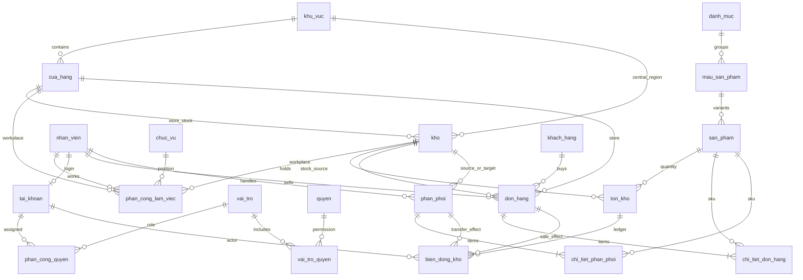

# ERD hiện hành (schema v3)

[`sql/data/01_create_database.sql`](../sql/data/01_create_database.sql) là định nghĩa chuẩn. Sơ đồ tách hồ sơ, chức vụ/nơi làm việc, tài khoản và phân quyền:

`phan_cong_lam_viec` giữ thời hạn, chức vụ và **một** nơi làm việc (cửa hàng hoặc kho) mỗi dòng. `phan_cong_quyen` giữ vai trò, thời hạn, trạng thái, khả năng ủy quyền và **một** phạm vi (hệ thống, khu vực, cửa hàng hoặc kho) mỗi dòng. Hai loại phân công độc lập. `ma_quan_ly` chỉ mô tả quan hệ báo cáo nhân sự; nó không cấp quyền.

Mỗi nhân viên có tối đa một tài khoản, số điện thoại nhân viên được lưu dạng `+84…` duy nhất. `auth_version` vô hiệu hóa token khi khóa hoặc đổi mật khẩu. `schema_version` lưu phiên bản/checksum cho các thay đổi sau này.

Giá bán và tổng giảm giá trên `chi_tiet_don_hang` là ảnh chụp tại lúc bán và luôn có giá trị. `don_hang` luôn chỉ rõ cửa hàng/kho, `phan_phoi` luôn chỉ rõ kho nguồn/đích. `ton_kho.so_luong` phải bằng tổng `bien_dong_kho.so_luong` theo từng kho/SKU; backend cập nhật cả hai trong cùng transaction. Seed demo tính số tồn trực tiếp từ ledger.
